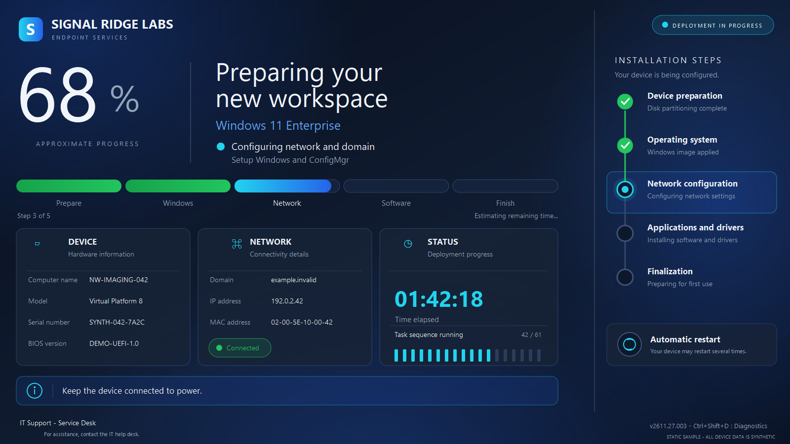

# OSD-OSD

OSD-OSD means On Screen Display of Operating System Deployments. Version 2 is a Windows PowerShell display for ConfigMgr operating system task sequences. It shows task sequence activity, an overall progress value, device details, elapsed time, a step timeline, and deployment status cards.

The display is intended for on-site technicians. It is not a replacement for `smsts.log` or the ConfigMgr task sequence progress UI.

## Current status

The repository contains the updated v2 script, a v2 example configuration, operator documentation, and a static mock render with fake device data. The mock render does not run the script.

Review findings are in [docs/review.md](docs/review.md). The task sequence setup guide is in [docs/task-sequence-setup.md](docs/task-sequence-setup.md). Configuration keys are in [docs/configuration.md](docs/configuration.md).

## Preview

The preview uses fake data. It does not contain a real hostname, serial number, IP address, or deployment log.

## Requirements

- Windows PowerShell 5.1.
- Windows Forms and System.Drawing support in the phase where the display runs.
- A ConfigMgr task sequence when live task sequence variables are required.
- A ConfigMgr package that contains the script and the selected JSON configuration.

The script shows preview progress values when a task sequence is not detected. It still reads real machine and network details in preview mode. Use the static render for an all-fake-data demonstration. Windows PE support depends on the boot image components and has not been validated in this repository.

## Quick start

1. Copy `config.example.json` to `config.json`.
2. Set the organization name, department, headline, colors, and step keywords in `config.json`.
3. Optionally place an organization logo beside the script and set `LogoPath` to its filename.
4. Run `osd-osdv2.ps1` in an approved Windows test environment.
5. Follow [the task sequence setup guide](docs/task-sequence-setup.md) to package and launch it.

Do not commit `config.json`. It is ignored because it can contain organization-specific data and a plaintext debug password. The example does not include a debug password.

## Files

| Path | Purpose |
|---|---|
| `osd-osdv2.ps1` | Windows Forms task sequence display. |
| `config.example.json` | Safe starter configuration. |
| `docs/task-sequence-setup.md` | ConfigMgr package and task sequence steps. |
| `docs/configuration.md` | Configuration key reference and keyword behavior. |
| `docs/review.md` | Review findings and known limits. |
| `render/osd-osdv2-preview.png` | Rendered v2 sample with synthetic data. |
| `render/osd-osdv2-preview.svg` | Editable source for the static render. |

## Task sequence state

The script stores `TSBackgroundStartTime` and `TSBackgroundCurrentStep` through `Microsoft.SMS.TSEnvironment`. Those values preserve data only while the task sequence environment is available. The script does not install a startup task or relaunch itself after a reboot. See [the setup guide](docs/task-sequence-setup.md) and [the review](docs/review.md) before deployment.

## License

No license has been selected. Do not redistribute this project until the owner adds a license.
