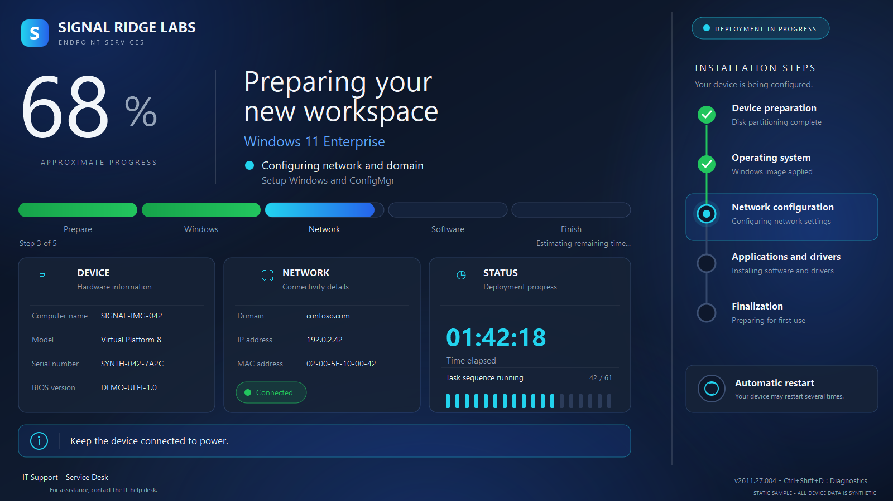

# OSD-OSD

OSD-OSD (On Screen Display of Operating System Deployments) is a Windows PowerShell display for ConfigMgr operating system task sequences. It presents deployment activity, approximate progress, device details, elapsed time, a step timeline, and deployment status to on-site technicians.

The display is intended for on-site technicians. It is not a replacement for `smsts.log` or the ConfigMgr task sequence progress UI.

## Preview

The preview uses fake data. It does not contain a real hostname, serial number, IP address, or deployment log. The domain, hostname, network values, and hardware values are illustrative.

## Requirements

- Windows PowerShell 5.1.
- Windows Forms and System.Drawing support in the phase where the display runs.
- A ConfigMgr task sequence when live task sequence variables are required.
- A ConfigMgr package that contains the script and the selected JSON configuration.

The script shows preview progress values when a task sequence is not detected. It still reads real machine and network details in preview mode. Do not use live preview mode for a recorded or shared demonstration. Use the static render for synthetic data. Windows PE support depends on boot image components and Windows Forms behavior. This repository has not validated it.

## Quick start

1. Copy `config.example.json` to `config.json`.
2. Set the organization name, department, headline, colors, and step keywords in `config.json`.
3. Optionally place an organization logo beside the script and set `LogoPath` to its filename.
4. Run `osd-osd.ps1` in an approved Windows test environment.
5. Follow [the task sequence setup guide](docs/task-sequence-setup.md) to create and distribute the package, add launch steps, and pilot the task sequence.

Do not commit `config.json` when it contains organization-specific values. The example contains only sample values. The Ctrl+Shift+D shortcut opens read-only diagnostics; it does not launch a command prompt or require a password.

## Files

| Path | Purpose |
|---|---|
| `osd-osd.ps1` | Windows Forms task sequence display. |
| `config.example.json` | Safe starter configuration. |
| `docs/task-sequence-setup.md` | Package setup and launch steps in Windows PE and full Windows. |
| `docs/configuration.md` | Configuration key reference and keyword behavior. |
| `docs/error-handling.md` | Success and error groups with explicit display state. |
| `docs/unattend-launch.md` | Optional early full Windows launch from unattend.xml. |
| `docs/attribution.md` | Microsoft Learn, source article, and figure credits. |
| `docs/review.md` | Current task sequence design and lab validation checks. |
| `tools/Start-OSDBackground.cmd` | Starts the display as a separate process. |
| `tools/Set-OSDBackgroundState.ps1` | Signals Running, Complete, or Failed to the display. |
| `tools/Exit-OSDBackgroundWithOriginalCode.ps1` | Returns the saved task sequence failure code. |
| `render/osd-osd-preview.png` | Static display image with synthetic data. |
| `render/osd-osd-preview.svg` | Editable source for the static render. |
| `LICENSE` | MIT license. |

## Task sequence state

The script stores `TSBackgroundStartTime` and `TSBackgroundCurrentStep` through `Microsoft.SMS.TSEnvironment`. Explicit `TSBackgroundState` signals control complete and failed status. Loss of the task sequence connection does not count as success. The script does not install a startup task or relaunch itself after a reboot. See [the setup guide](docs/task-sequence-setup.md), [error handling](docs/error-handling.md), and [the review](docs/review.md) before deployment.

## Releases

Each release includes release notes and GitHub's automatically generated source ZIP. The project does not publish an installer or a separate release package. The source ZIP contains the repository files for administrators to package in ConfigMgr.

## Attribution

The implementation and deployment procedures use Microsoft Learn documentation. Related ConfigMgr guidance by Jörgen Nilsson and Johan Schrewelius is credited in [attribution](docs/attribution.md). The setup guide credits each source figure.

## License

This project is licensed under the MIT License. See [LICENSE](LICENSE).
